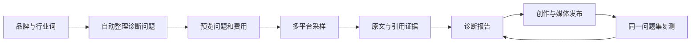

# GEO 诊断同行调研与产品方案建议

调研日期：2026-10-19。对象：本项目面向商家、代理和 OEM 的 GEO 诊断功能。

本次完成公开产品资料调研、用户提供报告的结构核对、现有实现的只读检查。同行能力以其公开文档为依据，未经付费实测；推荐方案属于本项目产品设计建议。本次未改动业务功能、启动监测或产生供应商费用。

## 1. 建议采用什么定位

建议采用“快速诊断获客 + 持续复测交付”的产品模式。商家从品牌和行业词开始，在一个流程内完成问题生成、诊断、查看证据与报告；运营人员可以把报告中的内容缺口转成创作任务，将发布后的文章纳入后续引用监测。

诊断分析、历史数据、报告和任务流由我们掌握；采集层支持自建网页采样、人工采样、官方模型 API 和第三方采集适配器。API 与用户端采样必须分别标识、分别比较。

我们的优势可以建立在已有的企业知识库、文章库、媒体资源和发稿记录之间的关联上。第一版先验证证据链和报告可信度，再扩大采集规模。

## 2. 同行做法与可借鉴点

以下为公开资料归纳，不代表市场份额、效果排名或对供应商采集质量的背书。

| 对象 | 已核对的公开能力 | 对我们的启发 |
| --- | --- | --- |
| 用户提供的友商表单与报告 | 少量输入、8 平台标签、推荐/风险问题、品牌及竞品统计、来源排行、优化建议 | 保持创建任务简单；增加原文证据、覆盖情况和明确的统计定义 |
| 模力指数 | 自定义问题监控、品牌/舆情/内容监控、报告及数据导出，公开提供 OEM 和 API 商务服务 | 将一次性报告和长期监测做成两个清晰入口；接口授权与支持范围另外验证。[官网](https://www.molizhishu.com/) |
| 独角兽 GEO | 区分品牌话题和行业话题，保存回答与引用，维护品牌别名，连接内容创作与复测 | 品牌认知与行业推荐分开统计，让每项优化建议关联具体采样。[使用手册](https://geo-docs.yueyuezi.com/product/manual) |
| Peec AI | 看板分别呈现可见度、声量份额、情感、位置和信源；支持下钻单个问题 | 避免仅展示一个综合分；以平台、问题、时间维度解释结果。[看板说明](https://help.peec.ai/article/part-4-reading-your-dashboard-phist06f5krvh02d6snjrvbc) |
| Ahrefs Brand Radar | 自定义问题可选择平台、地区与更新频率；品牌提及和网址引用有去重口径 | 保留问题版本和采样环境，明确一次回答重复提及如何计数。[问题监测](https://help.ahrefs.com/en/articles/13192745-how-to-set-up-custom-prompts-to-track-brand-visibility-in-ai-assistants)、[指标说明](https://help.ahrefs.com/en/articles/15501968-ai-visibility-metrics) |
| Semrush AI Visibility | 问题研究、日级定向问题监测、品牌表现和站点检查使用不同数据来源与周期 | 把需求研究、回答监测、网站可访问性分开，避免用不同口径拼出一个结论。[数据来源](https://www.semrush.com/kb/1607-semrush-ai-visibility-data) |

从这些样本可归纳出三种产品路线：一次性诊断报告、持续监测工作台、与内容/SEO 连接的综合工作台。这是本次样本归纳，并非完整行业普查。

Ahrefs 的部分曝光指标使用搜索量作为代理量；Semrush 也说明 AI 可见度属于方向性指标。我们缺少同等数据来源时，应展示本轮有效样本和提及比例，不提供未经验证的 AI 搜索量、真实曝光量或行业平均值。[Ahrefs 指标口径](https://help.ahrefs.com/en/articles/15501968-ai-visibility-metrics)、[Semrush 数据说明](https://www.semrush.com/kb/1607-semrush-ai-visibility-data)

## 3. 用户提供报告的核对结果

材料：[中翱集团_GEO品牌诊断报告.html](C:/Users/Administrator/Downloads/中翱集团_GEO品牌诊断报告.html)，报告标注生成时间为 2026-10-17 14:37:27；另有用户提供的创建表单截图。

只统计导出文件中“基础数据”表的实际行数，结果如下：

| 平台 | 品牌决策期问题行数 | 负面质疑期问题行数 |
| --- | ---: | ---: |
| DeepSeek | 0 | 0 |
| 豆包 | 10 | 10 |
| 腾讯元宝 | 10 | 10 |
| 千问 | 7 | 6 |
| 文心 | 5 | 6 |
| 纳米 | 9 | 7 |
| Kimi | 0 | 0 |
| 智谱 | 10 | 10 |
| 合计 | 51 | 49 |

这是文件展示的 100 行，不等于供应商实际提交或成功完成的任务总数。没有原始任务记录，不能计算真实完成率，也不能断言空表的原因。

需要借鉴和修正的地方：

- 问题反复使用“哪个服务商好”“哪家支持定制”“哪些公司有坑”等句式，推测使用行业词加模板，可能由 AI 辅助扩展；无法据此确定后台算法。
- DeepSeek 与 Kimi 的概览为 0%，但基础表为空。我们的“采样失败/缺失”必须与“有效回答未提及”分开。
- 报告没有提供足以逐条核验的完整回答、引用文章链接和采样环境。我们应允许从任何数字下钻到原始样本。
- 部分“提及品牌”列表包含网址、投诉平台和泛称。需要区分同行品牌、渠道平台、信源和一般实体；自动识别的竞品先作为候选。
- 品牌名称与关联企业名称是否为别名，需要商家确认，不能简单把所有近似公司名合并。
- 风险问题不等于负面回答。回答中出现一个企业名称，也不等于该企业被负面评价。
- 综合分为 2/100，但文件中未给出可复算公式。我们的第一版以明确指标和样本量为主，综合评分留待定义和验证。

## 4. 产品流程建议

### 4.1 创建任务

入口沿用“GEO诊断 → 开始诊断”，保留右侧“诊断记录”。无需为一次诊断新增侧边栏模块。

默认展示：

1. 品牌名称：从当前品牌带入。
2. 品牌简称/关联名称：从品牌资料带入，可编辑确认。
3. 行业词/核心产品：1—3 个，首次可手动输入。
4. 目标平台：显示该商家实际可用的平台，不可用平台说明原因。
5. “生成诊断问题”按钮。

官网、目标客户、服务地区、竞品作为补充信息折叠展示，可复用企业知识库，不要求用户在新表单重复填写全部资料。最终执行前仍须完成必要的品牌识别和诊断范围确认。

### 4.2 自动生成问题

采用“固定意图模板 + AI 结合企业信息扩展 + 去重和相关性检查”。问题生成由文本能力完成，采样回答由被测平台产生，二者是独立任务。

建议快速诊断默认生成 10 个总问题，而不是每填一个行业词就无限叠加。以下配额为第一版设计建议，可经真实试用调整：

| 意图 | 建议数量 | 示例 |
| --- | ---: | --- |
| 行业推荐 | 3 | 视频号团购服务商有哪些，分别适合什么商家？ |
| 具体场景 | 3 | 连锁餐饮要统一核销和对账，怎么选择视频号团购服务商？ |
| 比较与选型 | 2 | 自建团购系统和使用服务商，成本与维护有什么区别？ |
| 品牌认知 | 1 | 中翱集团主要提供哪些产品和服务？ |
| 风险与售后 | 1 | 选择视频号团购服务商前，需要核对哪些合同和售后条款？ |

品牌认知问题与未提示品牌名称的行业问题分别统计；风险题采用中性表达，避免把引导性问题产生的回答误作品牌事实。

每条问题保存行业词、意图、是否带品牌、生成来源、问题版本。用户可以修改、删除、重新生成；收费采样前展示最终问题、平台数量和费用。缺少文本通道时可使用明确标注的模板生成或手动输入。

AI 生成的问题标为“模拟客户问题”；客服咨询、销售记录、站内搜索等真实问题导入时标注来源，不生成虚构热度。

### 4.3 采样执行与证据

一个采样单元定义为：问题版本 × 平台 × 端/模式 × 地区 × 采样轮次。每次使用独立会话，不向被测回答注入品牌宣传资料，以免人为影响品牌自然出现情况。

每个单元保存：

- 原始问题、平台、实际可识别的模型/模式、时间、端、地区信息及来源通道。
- 回答原文、截图或其他可用凭证、实际引用、检索参考来源；来源能力不完整时标记“无法确认”。
- 成功、明确失败、执行中、待人工核对等状态，以及供应商任务回执。
- 原消费单和费用状态；重复取回结果不新建收费采样。

网页登录失效、验证码、限频、页面结构变化需可观察；无法继续时转人工处理，不通过伪造结果填补空位。官方 API 数据与网页端数据使用不同分组，通道切换后重新建立基线。

### 4.4 诊断报告

报告按用户决策顺序展示：

1. 本次诊断范围：问题数、平台、时间、有效/计划样本数和未完成原因。
2. 品牌表现：按平台、按问题类型展示提及与明确推荐。
3. 竞品对比：候选实体经归类后进入同行比较，保留别名与排除记录。
4. 回答明细：问题、是否提及、回答原文、引用、证据和时间。
5. 信源分析：站点/文章分别统计，区分实际引用与参考来源。
6. 可执行建议：每条建议带相关问题、采样证据和建议动作。
7. 历史变化：同一问题集、同一环境、同一通道复测对比。

先提供在线报告与独立 HTML 导出，再补 PDF 和受控分享。分享页默认去掉密钥、供应商内部回执与账单细节，保持租户、商家和品牌的数据隔离。

## 5. 建议固定的指标定义

以下是我们自己的拟定口径，不是把各家名称直接拼接。

| 指标 | 定义与边界 |
| --- | --- |
| 有效采样率 | 完整有效回答数 / 计划采样单元数；展示成功数和计划数 |
| 品牌提及率 | 提到确认品牌/别名的有效回答数 / 同一分组的有效回答数；同一回答重复出现只计一次 |
| 明确推荐率 | 明确向用户推荐品牌的回答数 / 同一分组有效回答数；未知结果单列，保留判断依据 |
| 负面描述占比 | 对品牌作出负面评价的回答数 / 提到该品牌的有效回答数；与“风险问题组”分开，展示分子分母及待核对数 |
| 已跟踪竞品提及份额 | 某品牌提及回答数 / 所有已确认跟踪品牌的提及回答数之和；说明比较集合，不称真实市场份额 |
| 推荐位置 | 仅在回答明确形成推荐列表且品牌出现时统计；无排序、仅提及和未提及分开，不赋予虚构排名 |
| 媒体引用次数 | 某站点被实际引用的回答数；同一回答内同一站点去重，文章维度另计 |
| 自有内容引用率 | 引用了已确认自有/已发布文章的回答数 / 可确认引用状态的有效回答数；不可观测引用时不填 0 |

零个有效样本时比例显示“—”。全平台汇总必须同时展示平台覆盖和样本分布，比较期间使用相同的可比范围；不能因某个平台故障、问题集变化而制造提升。

第一版不提供“AI真实曝光量”“全网收录率”“保证推荐”“未经来源验证的行业均值”。若未来引入搜索需求数据，需单独说明来自哪个搜索平台及时间范围。

## 6. 如何连接已有媒体发布能力

让诊断产生三种直接行动：

- 回答缺少品牌信息：根据相关问题和知识库建立内容任务，审核后入文章库。
- 回答有事实错误：生成待核查项，关联品牌资料与实际回答。
- 某些媒体在特定问题中频繁被引用：将可确认匹配的媒体列为候选，点击查看证据和报价。

媒体资源目录和信源匹配必须谨慎：保存文章 URL、站点、域名和媒体目录关系。同一域名可能包含大量频道/自媒体账号，不能把一个账号的引用推广为所有同域媒体均有同等效果。

建议标签示例：“近30天 · 豆包 · 5个问题中被引用12次”，附有效样本量与查看证据入口。它描述本系统观察，不表示包收录或保证被某 AI 引用。

发布成功后保存实际回链；在后续固定问题采样中追踪该文章是否被引用。发稿时间与提及率变化的关联也不自动构成因果证明。

## 7. 自建与采购的三种选择

| 路线 | 优点 | 主要代价 | 建议 |
| --- | --- | --- | --- |
| 自建分析报告 + 可替换采集通道 | 数据、品牌识别、报告和业务闭环可控，能逐平台接入自建采样 | 仍需验证各通道的数据与稳定性 | 推荐；第三方是可选采集来源 |
| 八个平台采集、分析全自建 | 控制面最大，可按业务需要调整采样 | 登录、限频、页面变化、调度、取证维护工作量大 | 用小样本先验证，再逐步扩大 |
| 采购成品 OEM | 初期产品交付较快 | 依赖供应商的指标、数据导出和授权，二次融合空间需确认 | 可作对照，不优先替换现有系统 |

采集供应商选择以测试为准：要求返回任务 ID、真实原文、时间、引用和可核验凭证，并明确端、模式、重复任务处理、失败/超时计费以及数据导出和 OEM 使用范围。仅展示平台 Logo 不能作为接通证明。

## 8. 当前项目可复用的内容与缺口

只读检查到的实现：

| 现有基础 | 主要缺口 |
| --- | --- |
| 品牌资料、行业/产品/客户/竞品字段 | 创建诊断时带入、确认品牌别名、减少重复填写 |
| `GeoJobs` 的关键词/文本生成、网页检索和原算力流水 | 面向诊断的结构化问题生成、去重、预览和版本固定 |
| `GeoWorkflow` 的项目、人工采样、轮次、提及分组和优化任务 | 独立诊断向导、实体识别、明确推荐/情感/信源指标 |
| `GeoVisibility` 的费用预览、任务与定期复测 | 采集适配器注册与平台能力状态；扩大平台前验证队列容量 |
| `VisibilityRuns` 的原文、截图、引用和参考来源展示 | 统一完整报告、HTML/PDF导出、引用到媒体资源关联 |
| 文章库、媒体发布和实际订单 | 从诊断证据创建内容任务、发布回链与后续引用关联 |

代码边界：

- 工作流允许人工选择 8 个平台，但自动接口目录目前只有 DeepSeek、豆包、腾讯元宝、通义千问、Kimi 5 个。这不代表 5 个已经完成实测，更不代表 8 个已可自动采集。
- 自动诊断当前每轮最多 150 个问题×平台组合；10 题×8平台为 80，20题×8平台为160，会超限。扩大套餐前要同时处理排队、容量和预算，不能只扩 UI 选择项。
- 配置当前有“模力指数 · 域明科技”的混合命名。已核对模力指数官网主体是深圳光明人工智能研究院有限公司；域明文档适配不能据此当作官方模力接口。后续应核实供应商身份和合同协议再修正配置名称。
- 旧文档含不同时期的候选供应商记录。本次以实际代码结构和供应商当前公开资料描述功能边界；没有重新读取商家账户的实时开通状态。

## 9. 分阶段交付与验收

### 阶段一：验证采样与问题质量

用一个经确认的品牌、10个固定问题、目标8个平台做计划80个单元的验证。仅在平台采样方式可用、账号条件满足后执行；不可用平台明确记录，不用另一模型冒名补齐。

验收：每个成功样本有完整回答、时间和来源；引用可观测时能核对网址；失败样本不算未提及；已有任务不会因超时重复收费；至少复核一轮实体识别，区分公司、媒体、平台和泛称。

### 阶段二：最小可用诊断产品

完成品牌/行业词输入、问题生成预览、平台与费用预览、任务进度、证据下钻、分平台统计和 HTML 报告。只对已验证的平台开放自动诊断。

验收：任一报告指标能回到具体样本；零样本不显示0%；品牌问题与行业问题分开；报告记录问题和统计版本；分享和导出不泄漏其他商家数据。

### 阶段三：持续复测与业务闭环

支持固定问题集定期监测、历史对比、已发布文章引用追踪、按问题提出创作和媒体建议。扩大平台覆盖必须通过阶段一同样的验证。

验收：范围变化显式标记；媒体标签附采样窗口与证据；定时任务有预算和轮数限制；内容审核与发稿仍分别由用户确认。

## 10. 成本设计

计划采样数 = 问题数 × 所选可用平台数 × 采样轮数。

例如10题、8平台、1轮为80个单元；每周一次、4轮为320个单元。实际费用还取决于各通道单价、截图/深度思考选项、文本生成和分析用量、人工及采集维护成本，不能把友商截图中的11元当作我们的采购成本或可复制售价。

前台显示生成问题的费用说明、本轮采样预估、实际消耗及待核对部分。后台沿用当前平台/OEM算力与授权体系。默认生成一次诊断，持续付费复测需要用户明确设置周期、轮数和预算。

## 11. 产品结论

第一版的完成标准是：用户少填资料，能得到一份有原文证据、统计可复算、范围清晰的诊断报告，并能将发现的问题交给已有创作与发布模块处理。报告导出负责交付，固定问题复测负责持续验证，供应商适配负责扩展覆盖。

当前交付是调研与方案文档，尚未实现上述新增功能。
