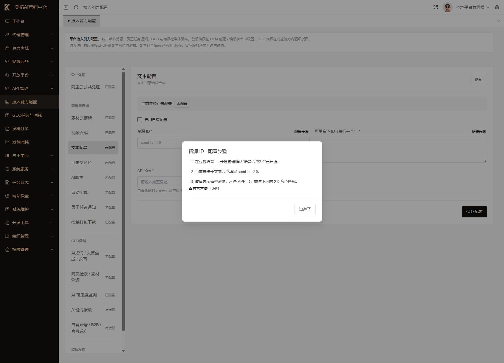

# 火山引擎接入配置教学

适用环境：美拓 AI 营销中台本地平台后台。核对日期：2026-10-20。

本文不包含 API Key、登录密码或验证码。配置保存代表字段完整，只有实际任务成功才代表业务联通。

## 配置入口与对应服务

打开[平台接入能力配置](http://127.0.0.1:8090/platform/integration/config)。各参数框右上角的“配置步骤”提供三步短教程；阅读或关闭教程不会改变参数，也不会触发未保存提示。

| 中台能力 | 火山产品 | 参数来源 |
| --- | --- | --- |
| 文本配音 | 豆包语音合成2.0 | 新版语音 API Key、模型资源 ID、系统音色 ID |
| 自定义音色 | 豆包声音复刻2.0 | 新版语音 API Key、模型资源 ID、已完成复刻的音色 ID |
| AI 脚本 | 火山方舟文本模型 | 方舟 API Key、支持 Responses API 的 Model ID 或推理接入点 |
| 自动字幕 | 豆包录音文件识别2.0 | 新版语音 API Key、标准版识别资源 ID |

豆包语音 Key 与方舟 Key 分别维护。不要填阿里云 AccessKey、火山 IAM AccessKey、旧版语音 APP ID / Access Token 或 Agent/Coding Plan 专用凭证。

## 1. 先核对账号与开通状态

1. 登录[火山引擎控制台](https://console.volcengine.com/)，核对账号和资源项目。
2. 打开[豆包语音](https://console.volcengine.com/speech) → 开通管理，查看目标服务是否已开通。
3. 免费体验中心可用不等于正式 API 已开通。开通页会显示条款、单价、并发与后付费规则。
4. 账号余额不足时先由账号负责人充值，再刷新开通管理。
5. 由负责人确认具体服务的开通条款和费用后，提交最终开通。

本次语音合成2.0确认页显示字符版价格为 **0.0003 元/字**，并发限额为 10；剩余免费额度转入当前项目，耗尽后按页面说明继续计费。其他产品价格独立计算，以当时开通页为准。

旧账号曾返回“当前账号为伙伴专用账号，无法下单”，充值不能解决账号类型限制。切换到新主账号（尾号 9298）后，已完成语音合成2.0、录音文件识别2.0及 Doubao-Seed-2.1-lite 的开通，并保存到中台平台配置。

## 2. 文本配音

1. 在豆包语音开通“语音合成2.0”。
2. 打开“API Key”，选择服务所在资源项目，取得当前项目可用 Key。已有可用 Key 优先复用；创建新 Key 时核对权限。
3. 打开“音色库”，选择语音合成2.0支持的音色，复制实际 speaker / 音色 ID。
4. 回到中台“文本配音”，勾选“启用自有配置”，填写下表并保存。

| 参数 | 填写方式 |
| --- | --- |
| 资源 ID | `seed-tts-2.0` |
| 可用音色 ID | 每行一个实际音色 ID，不填中文音色名称 |
| API Key | 新版豆包语音 API Key |

本次在 `default` 项目创建长期 Key `meituo-aigc-speech`，由文本配音和自动字幕复用。Key 的值只保存在中台凭证配置，不写入教程。当前保存的系统音色为：

| 音色名称 | 音色 ID |
| --- | --- |
| 小何 | `zh_female_xiaohe_uranus_bigtts` |
| 温暖阿虎 | `zh_male_wennuanahu_uranus_bigtts` |
| 解说小明 | `zh_male_jieshuoxiaoming_uranus_bigtts` |
| 广告解说2.0 | `zh_male_guanggaojieshuo_uranus_bigtts` |

中台使用异步长文本合成接口。保存后需在有权限的商家工程中选择音色、提交配音，并检查生成音频及入库结果。参考[官方任务提交接口](https://docs.volcengine.com/docs/DoubaoVoice/Tasksubmission?lang=zh)。

## 3. 自定义音色

### 管理员一次配置

1. 在豆包语音开通管理中开通“声音复刻2.0”和“音色槽位 → 后付费音色”，由账号负责人确认条款及费用。本次新账号两项均已开通，尚未创建收费测试音色。
2. 在平台“接入能力配置 → 自定义音色”勾选“启用自有配置”。
3. 资源 ID 填 `seed-icl-2.0`，“用户上传复刻”选“开启用户上传复刻（后付费音色）”，API Key 复用同项目的 `meituo-aigc-speech`，保存。
4. “已有公共音色 ID”可留空。用户上传的个人音色由系统自动保存到各自账号，不需要管理员逐个填写。此公共字段仅用于允许该 OEM 商家共同使用的既有音色。
5. 为需要使用的 OEM 配置自有服务，或在平台 OEM 编辑页授权借用平台配置。现有借权是统一剪辑云能力开关，不是单项声音复刻开关；应由平台负责人确认费用承担范围。配音生成后保存素材还需要有效 OSS 配置。

每个参数框右上角的“配置步骤”都可查看简短说明和官方入口。

### 商家上传、试听和重复使用

1. 进入“视频剪辑”，点击右上方“我的音色 → 上传声音”。
2. 输入容易辨认的名称，选择 5～60 秒、不超过 10 MB 的单人录音（wav、mp3、ogg、m4a、aac）。使用安静环境下的普通话，避免音乐和其他人声。
3. 确认本人声音或已取得权利人授权，并同意提交给火山引擎处理；点击“上传并开始复刻”。
4. 等待状态变为“待试听启用”，直接在中台播放试听。页面会自动更新处理中的任务；试听链接过期可点“更新状态与试听”重新获取，不必重新上传。
5. 满意后选择该音色，在“生成旁白配音”中输入文案，勾选首次启用确认，再提交配音。首次正式合成会触发音色槽位费用；普通刷新和查询不会执行正式合成。
6. 以后在当前账号的“我的音色”或“生成旁白配音”选择器中直接使用，无需每次到火山控制台复刻。已启用音色不能重新训练覆盖；需要另一种声音时新建音色。

当前后付费音色价格为首次正式配音 **138 元/音色**；声音复刻2.0配音按 **0.0003 元/字**。训练生成的试听也产生字符费用，上传并非完全免费。云服务费用由所用云账号承担；中台不会自动为测试创建或启用音色。试听音色若 7 天内未正式合成会被云端删除，页面显示到期时间；届时需重新上传。价格以官方当期页面为准。参见[下单及使用指南](https://docs.volcengine.com/docs/DoubaoVoice/Soundreplicationorderingandusageguide?lang=zh)和[计费说明](https://docs.volcengine.com/docs/DoubaoVoice/Billinginstructions-21?lang=zh)。

个人音色按 OEM 和商家账号隔离，声音样本保存在服务端非公开目录。用户只看到音色名称和状态，不收到云服务 Key。上传结果不确定时系统查询原音色，不自动重复训练；超时会提示人工核查。更换服务 Key、云配置来源或资源 ID 后，旧音色会暂停使用，应先核对原云账号，不能当作新账号音色调用。

部署时运行 `php scripts/install-clip-voices.php`（或更新后的剪辑模块安装脚本），并重启 `merchant-clip:work` 工作进程。需要可用 ffprobe 验证真实音频时长，PHP 上传大小限制至少覆盖 10 MB 样本。备份数据库时同时保护 `runtime/merchant-voices`，该目录不得作为公开静态资源发布。

接口依据：[音色训练](https://docs.volcengine.com/docs/DoubaoVoice/tone-training-http?lang=zh)、[音色查询](https://docs.volcengine.com/docs/DoubaoVoice/tone-query-http?lang=zh)、[异步配音](https://docs.volcengine.com/docs/DoubaoVoice/Tasksubmission?lang=zh)。

## 4. AI 脚本

1. 打开[火山方舟](https://console.volcengine.com/ark)，选择北京区域。
2. 如弹出跨服务授权，先核对 `ServiceRoleForArk` 的授权范围。当前页面涉及 TOS、VPC、机器学习平台等资源，由账号负责人确认。
3. 在开通管理中选择适合文本脚本、支持 Responses API 的模型并核对开通状态。
4. 复制实际 Model ID，或在线推理中已运行的接入点 ID。
5. 打开“API Key 管理”，取得有权调用该模型的方舟 Key。
6. 在中台“AI脚本”填写模型/接入点 ID 和方舟 Key，启用并保存。

中台调用北京区域的 `Responses API`。语音 Key 与方舟 Key 不能互换。模型显示名称、Model ID、推理接入点 ID 是不同字段，必须复制调用示例中的标识。参考[官方 API Key 管理说明](https://console.volcengine.com/ark/region%3Acn-beijing/docs/manage-api-keys)。

本次填写 `doubao-seed-2-1-lite-260915`，复用账号已有的 `api-key-20251212120138`。模型开通页显示 50 万免费 tokens，基础文本输入 0.0008 元/千 tokens、输出 0.0027 元/千 tokens；实际收费随输入类型、缓存等条件变化，以官方当期计费为准。[官方模型列表](https://docs.volcengine.com/docs/ark/model-list?lang=zh)列出该模型及接口支持。

## 5. 自动字幕

1. 打开豆包语音 → 开通管理 → 录音文件识别2.0，核对并确认条款及费用。
2. 在中台“自动字幕”勾选“启用自有配置”，资源 ID 填 `volc.seedasr.auc`。
3. 填写同项目新版语音 API Key；本次复用 `meituo-aigc-speech`，启用并保存。
4. 在商家剪辑工程选择受支持的音频，提交识别。处理期间等待查询结果，完成后检查字幕文本和分句时间。

本次云端开通后显示 **20 小时免费额度**，耗尽后按 **0.8 元/小时** 后付费。当前中台限制音频不超过 100 MB、2 小时；2.0 接受 mp3、wav、ogg。系统已适配标准版异步提交和查询，查询异常只查询原任务，超过本地 6 小时等待上限则提示人工核查，不会自动重复提交。

已有极速版用户仍可保留 `volc.bigasr.auc_turbo`，系统继续使用原同步接口。不要填流式识别资源 ID。参考官方[任务提交](https://docs.volcengine.com/docs/DoubaoVoice/task-submission-http-1?lang=zh)、[结果查询](https://docs.volcengine.com/docs/DoubaoVoice/result-query-http-1?lang=zh)与[极速版接口](https://docs.volcengine.com/docs/DoubaoVoice/recording-file-recognition-lite-http?lang=zh)。

## 6. 平台保存与商家使用的区别

平台保存的参数不会自动向所有 OEM 开放。OEM 可以配置自身服务，也可以在平台明确授权后借用。本次经用户确认，已为体验 OEM（tenant_id=1）开启平台剪辑云服务借权，调用费用由平台云账号承担。

设置路径：平台后台 → 代理管理 → 代理列表 → 本地体验租户 → 编辑 → 勾选“允许借用平台新增能力配置”→ 保存。商家刷新“视频剪辑”页面后，“我的音色 → 上传声音”即可进入上传表单。其他 OEM 仍需分别授权；GEO 的独立借权不受此开关影响。

“已配置”表示字段完整；“待配置或授权”可能是 OEM 没有自有配置，也没有平台借权。不要为消除提示而填写假的音色、模型或 Key。

## 7. 联调清单

1. 明确使用的商家、工程、云账号及一次测试允许的费用。
2. 文本配音：用短文本生成音频，检查播放、音色和素材入库。
3. AI 脚本：生成短篇脚本，检查响应内容与任务状态。
4. 自动字幕：用已授权的短音频检查识别文本和时间。
5. 自定义音色：使用用户授权样本，验收上传、训练状态、试听、首次付费确认与之后复用；先确认测试费用。
6. 留存中台任务号、云端任务号、时间、实际费用及结果，日志中不记录 Key。

## 8. 参数教程的维护与验证

教程覆盖阿里云公共凭证、OSS、IMS、IMM、火山四项能力、微信通知、GEO 与海讯社的参数框，以及配置来源/方式选择框。开关维持原布局。

教程按钮是独立按钮，不提交表单；Esc 或“知道了”均可关闭，关闭后焦点回到原按钮。真实输入改动依然会在切换能力时提醒；仅打开教程和原值恢复不会误报。

最终配置结果及仍需用户确认的事项以[本次操作记录](./火山引擎配置操作记录-2026-10-20.md)为准。
