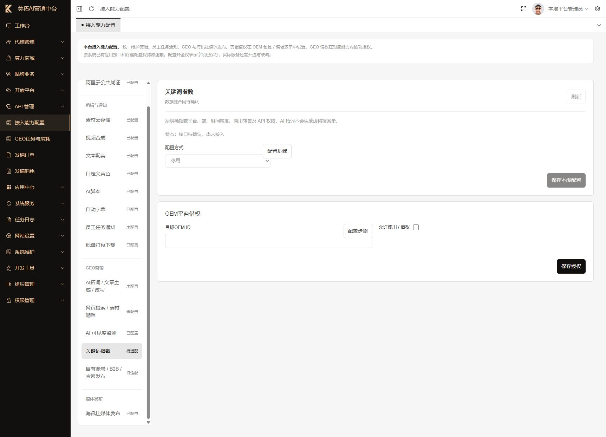
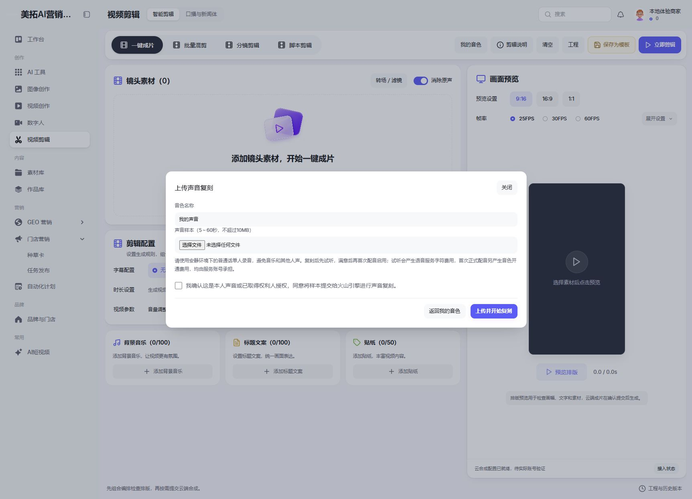
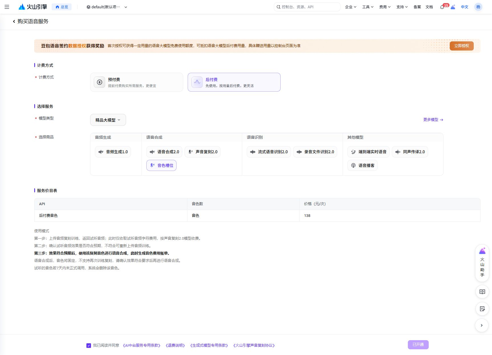
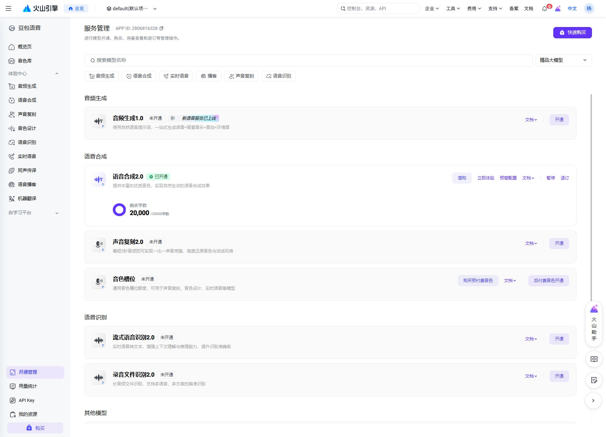
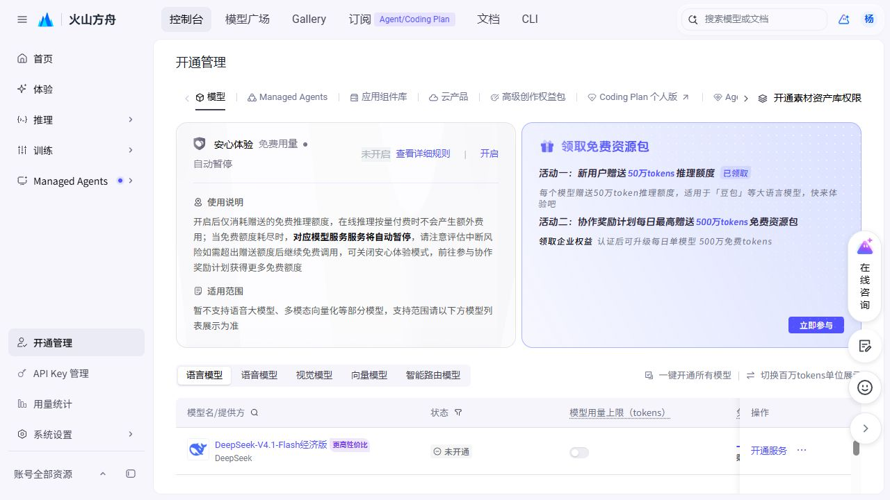
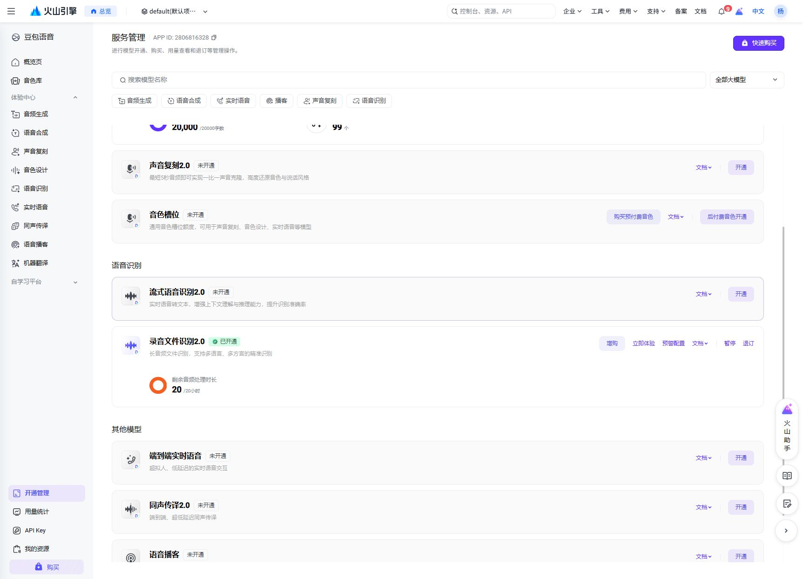

# 火山引擎配置操作记录

日期：2026-10-20。目标：配置中台火山能力、编写教程，并在各参数框右上角提供简短步骤。

## 最终配置

使用新主账号（账号尾号 9298），资源项目 `default`，豆包语音 APP ID `2806816328`。以下“已配置”代表云端开通并保存参数，尚未提交真实业务生成任务验证。

| 能力 | 云端状态与参数 | 中台状态 |
| --- | --- | --- |
| 文本配音 | 语音合成2.0已开通；`seed-tts-2.0`；配置小何、温暖阿虎、解说小明、广告解说2.0四个真实音色 | 已保存并启用 |
| AI脚本 | Doubao-Seed-2.1-lite已开通；`doubao-seed-2-1-lite-260915` | 已保存并启用 |
| 自动字幕 | 录音文件识别2.0已开通；`volc.seedasr.auc` | 已保存并启用 |
| 自定义音色 | 声音复刻2.0、后付费音色已开通；`seed-icl-2.0` | 已保存并启用用户上传复刻；体验 OEM（tenant_id=1）已获平台借权 |

## 过程与授权

1. 旧账号“中翱集团AI”提交语音开通后返回“当前账号为伙伴专用账号，无法下单”。用户决定换账号。
2. 新账号核对完成后，用户明确确认语音合成2.0条款与费用、方舟 `ServiceRoleForArk` 跨服务授权，均执行成功。
3. 用户确认在 default 项目创建长期语音 Key `meituo-aigc-speech`，已创建并保存到本地中台。文本配音和字幕复用该 Key。没有在文档、截图或日志记录密钥值。
4. 用户确认开通 Doubao-Seed-2.1-lite，云端显示已开通。复用已有方舟 Key `api-key-20251212120138`，没有新建或修改其权限。该 Key 与语音 Key 分别保存。
5. 用户确认录音文件识别2.0条款及费用，已提交开通，云端显示已开通及 20 小时剩余免费额度。
6. 依次在平台接入能力配置保存文本配音、AI脚本、自动字幕，确认保存成功。
7. 用户要求补齐个人音色流程，并明确批准在新账号开通“声音复刻2.0”和“后付费音色”，同意四项条款和首次启用音色 138 元、配音 0.0003 元/字的费用。两项云端开通已完成，后付费购买页显示“已开通”；没有创建或正式启用任何收费测试音色。
8. 平台自定义音色填写 `seed-icl-2.0`，开启“用户上传复刻（后付费音色）”，复用既有语音 Key，公共音色列表留空。已确认保存成功并显示“已配置”。
9. 用户明确批准体验 OEM（tenant_id=1）借用平台已配置的剪辑云服务，并确认费用由平台云账号承担。在平台“代理管理 → 代理列表 → 本地体验租户 → 编辑”勾选“允许借用平台新增能力配置”并保存。该开关涵盖当前新增剪辑及员工任务通知能力，实际仍以平台已配置服务为准；GEO 使用独立借权，未随此开关开通。

本次确认页：语音合成2.0为 0.0003 元/字，免费 20,000 字；字幕为 0.8 元/小时，免费 20 小时；文本模型免费 50 万 tokens，基础文本输入 0.0008 元/千 tokens、输出 0.0027 元/千 tokens。免费额度耗尽后按服务规则扣费，实际价格以云端当前页面为准。

## 配套修改

- 每个参数框右上角提供“配置步骤”：三步说明及官方入口，覆盖公共凭证、剪辑、微信通知、GEO、海讯社以及配置方式选择框。
- 阅读教程不改变表单；仅实际改动时提示未保存，Esc 或“知道了”关闭后焦点回到原按钮。
- 新增字幕2.0异步提交/查询；保留已有极速版同步调用。轮询读取 HTTP 状态头，不把排队当成功。
- 查询网络错误只重试查询，提交结果不确定不自动重发。处理超过本地 6 小时上限后等待人工核查。
- 配置版本变化会阻止任务继续使用不同账号凭证。
- 新增个人音色列表、上传、训练查询、试听、重命名、首次启用确认与配音选择器；数据按 OEM 和商家账号隔离，样本存在非公开目录。
- 训练请求使用稳定的自定义音色标识，网络异常或进程中断后只查询原音色，不自动重训。未启用试听 7 天过期，已启用音色可继续复用。

## 验证与限制

- 字幕适配：24 项模拟与事务检查通过，涵盖成功、静音、排队、无效音频、网络异常、配置变更和避免重复提交。
- 批量打包：33 项回归检查通过。
- 表单状态：10 项检查通过；前端语法检查通过。
- 个人音色：32 项模拟和数据库事务检查通过，包括用户隔离、授权确认、真实音频校验、重复上传去重、异步恢复、首次合成确认、过期后重建及启用后复用。
- 浏览器此前逐项检查教程入口无遗漏，实际修改会提醒，仅阅读教程或切换未修改的配置不会误报。
- 测试使用模拟云请求，临时数据库改动全部回滚；未使用实际 Key 发起生成或识别任务。
- 后续真实联调应选择有权限的商家与已授权素材，检查配音播放、脚本文本和字幕时间。
- 确认无待处理剪辑任务后重启了剪辑处理进程；新进程运行正常。刷新页面后确认字幕资源 ID 保留，查看教程并切换能力没有未保存误报。
- 本次个人音色表迁移完成；确认剪辑和复刻队列均空闲后重新启动工作进程，已加载复刻任务处理逻辑，日志未见错误。
- 浏览器已检查“我的音色”和“上传声音复刻”的桌面与 390px 手机弹窗，无横向溢出，未发现 JavaScript 错误。借权前上传按钮按权限禁用；授权后刷新商家页，上传按钮可用，能正常进入表单。空样本、未确认权利授权时提交被阻止，显示必填提示，没有创建复刻任务。
- 本次没有真实声音样本，因此真实训练、试听音质、首次付费合成及素材入库尚未进行云端验收；本地模拟检查不能替代这些步骤。

完整步骤见[火山引擎接入配置教学](./火山引擎接入配置教学-2026-10-20.md)。

