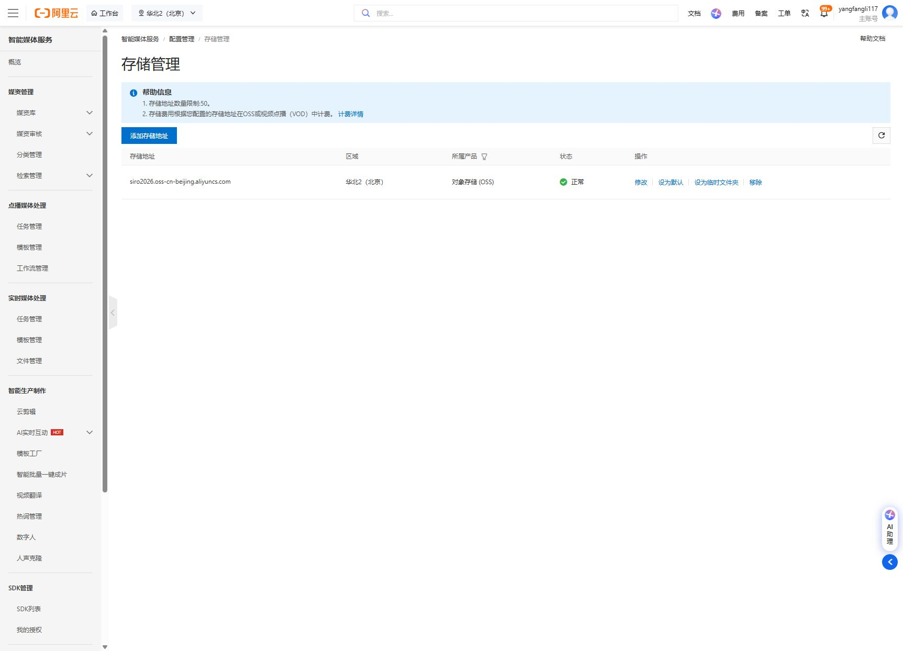
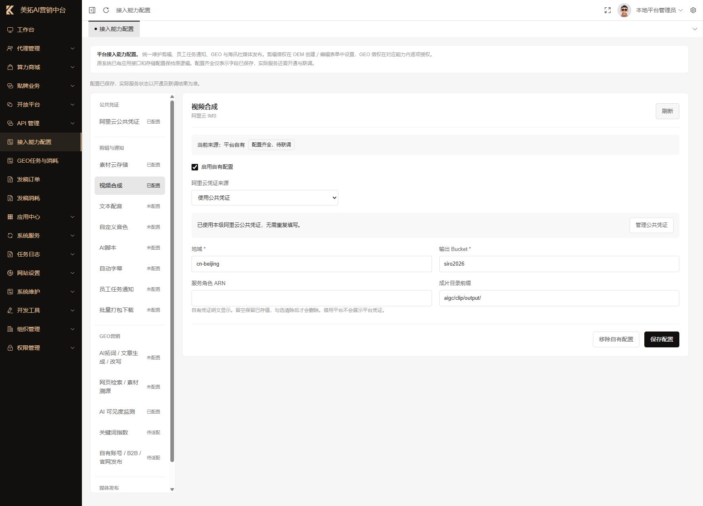
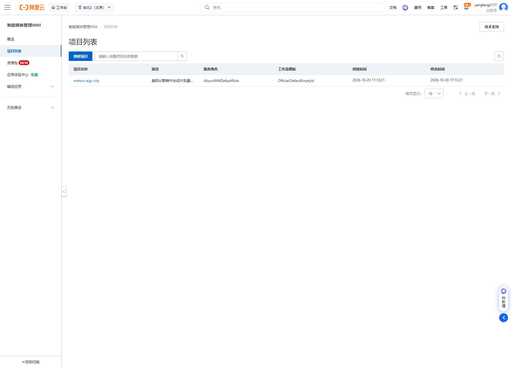
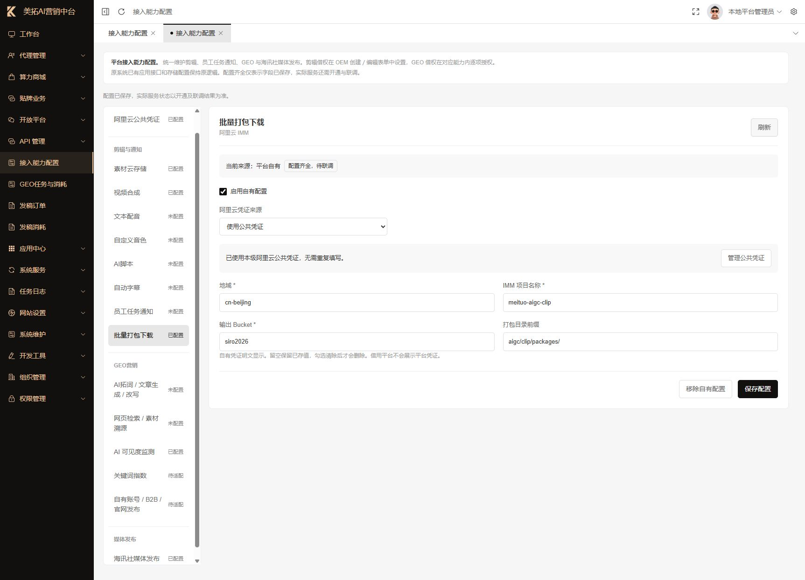

# 阿里云接入配置教学

适用系统：美拓 AI 营销中台本地环境  
配置日期：2026-10-20  
适用人员：平台管理员、后续部署及维护人员

本文记录本次实际保存的配置，并说明以后如何重做。文档不包含 AccessKey、Secret 或登录密码。账号、密钥、套餐状态应以当前控制台为准。

## 1. 本次完成了什么

| 接入项 | 当前结果 | 验证程度 |
| --- | --- | --- |
| 阿里云公共凭证 | 沿用已有配置，与原 OSS 凭证一致 | 已核对本地配置一致性 |
| 素材云存储 OSS | 已改为使用公共凭证，沿用北京 `siro2026` | 已保存，尚未做真实上传测试 |
| 视频合成 IMS | 已启用，使用公共凭证、北京地域和 `siro2026` 输出 | 已保存，尚未做真实合成测试 |
| IMS 北京存储地址 | 新增登记 `siro2026.oss-cn-beijing.aliyuncs.com` | 阿里云控制台显示“正常” |
| 批量打包下载 IMM | 已授权默认角色、创建北京项目并保存配置，程序适配已补齐 | 33 项本地检查通过，真实云端打包待验收 |
| 全站上传存储 | 继续使用本地存储 | 已核对设置页，没有迁移旧资源 |

本次完成的是配置保存和云端资源登记。页面中的“已配置”不等于真实业务已联通，当前仍需做一次素材上传、视频合成和下载验收。

**同日最终状态：**用户完成 IMM 开通，明确确认默认角色授权并亲自完成身份验证后，已完成 `AliyunIMMDefaultRole` 授权及 `meituo-aigc-clip` 项目创建。平台 IMM 已启用并使用公共凭证。当前本地体验商家所属 OEM 尚未获准借用平台能力，所以商家端仍显示“待配置或授权”；本次没有扩大 OEM 借权范围，也没有提交会产生费用的真实合成、打包任务。默认角色关联 `AliyunIMMRolePolicy`，其 OSS 权限范围不限于 `siro2026`，详见[官方角色权限说明](https://help.aliyun.com/zh/imm/user-guide/configure-a-service-role-for-a-project)。

## 2. 需要记住的入口

| 用途 | 入口 |
| --- | --- |
| 中台公共凭证、素材存储、视频合成 | [平台后台 → 接入能力配置](http://127.0.0.1:8090/platform/integration/config) |
| 全站上传存储 | [平台后台 → 网站设置 → 存储设置](http://127.0.0.1:8090/platform/setting/storage) |
| 查 Bucket 和所在地域 | [阿里云 OSS 控制台](https://oss.console.aliyun.com/bucket) |
| IMS 存储登记 | [智能媒体服务 → 配置管理 → 存储管理](https://ice.console.aliyun.com/settings/storage) |
| IMS 访问 OSS 的授权 | [智能媒体服务 → 配置管理 → 服务授权](https://ice.console.aliyun.com/settings/auth) |
| IMM 项目管理 | [智能媒体管理 → 北京项目列表](https://imm.console.aliyun.com/v2/cn-beijing/projects) |
| 查现有 RAM 用户及权限 | [访问控制 RAM](https://ram.console.aliyun.com/) |

本地地址只适用于当前电脑运行的中台。正式部署后，替换为实际后台域名。

## 3. 先统一地域和存储桶

本次采用以下组合：

| 参数 | 填写值 | 如何确认 |
| --- | --- | --- |
| 控制台地域 | 华北2（北京） | OSS Bucket 列表的地域列 |
| 程序地域 ID | `cn-beijing` | 北京地域对应的 ID |
| 素材 Bucket | `siro2026` | 现有 OSS Bucket 名称 |
| 合成输出 Bucket | `siro2026` | 与 IMS 地域一致 |
| 合成输出目录 | `aigc/clip/output/` | 中台内设置的成片目录前缀 |

Bucket 字段只填名称，不填域名或完整 URL。阿里云官方说明 IMS 不支持跨地域处理，应让输入、输出存储与任务地域一致。[官方说明](https://help.aliyun.com/zh/ims/support/product-activation-faq)

账号中的杭州 `zcppk2` 和上海 `czppk` 是其他现有资源，本次没有调整。

## 4. 公共凭证只维护一次

1. 打开中台“接入能力配置”，点击“阿里云公共凭证”。
2. 已有配置时，优先沿用并核对账号归属。不要重复新建密钥。
3. 首次配置可输入一对配套的 AccessKey ID 和 AccessKey Secret；若素材云存储已有正确凭证，可点“素材云存储”导入。
4. 点击“保存公共凭证”。
5. 打开各项阿里云能力，把“阿里云凭证来源”选择为“使用公共凭证”，分别保存。

本次刷新旧页面时发现公共凭证已由其他窗口保存，因此沿用最新值。遇到“已在其他窗口更新”，先刷新核对，再决定是否修改，不要强行覆盖。

只有选择了“使用公共凭证”的服务才会跟随这份凭证；仍选择“本服务独立凭证”的服务不会自动切换。这里的公共凭证覆盖接入能力中的 OSS、IMS 和 IMM，不会自动同步原系统的全站存储或短信配置。

凭证页按当前系统设计明文展示。编写教程、截图或交接时，不要把实际密钥复制进去。

## 5. 配置素材云存储 OSS

打开“接入能力配置 → 素材云存储”：

| 字段 | 本次值 |
| --- | --- |
| 启用自有配置 | 勾选 |
| 阿里云凭证来源 | 使用公共凭证 |
| 地域 | `cn-beijing` |
| Bucket | `siro2026` |
| 素材目录前缀 | 沿用原值，空白 |

点击“保存配置”，确认出现保存成功提示。此处是剪辑素材专用配置，与“网站设置 → 存储设置”是两个入口。

## 6. 在 IMS 中登记 OSS

1. 打开阿里云“智能媒体服务”。
2. 顶部地域选择“华北2（北京）”。
3. 打开“配置管理 → 存储管理”。
4. 点击“添加存储地址”。
5. 所属产品选择“对象存储（OSS）”。弹窗默认可能选中 VOD，本方案不需要为此新开通 VOD。
6. 点击“选择”，确认 Bucket 为 `siro2026`，选择根路径并确定。
7. 返回新增弹窗，确认显示 `http://siro2026.oss-cn-beijing.aliyuncs.com/`，点击确定。该地址是控制台选择器自动生成的存储登记值；中台生成的对象访问地址使用 HTTPS。
8. 列表应出现 `siro2026.oss-cn-beijing.aliyuncs.com`，地域为北京，状态“正常”。

本次仅登记存储地址，没有设为默认地址或临时文件夹。中台提交合成任务时会明确指定输出位置。

## 7. 配置视频合成 IMS

打开中台“接入能力配置 → 视频合成”：

| 字段 | 本次值 | 说明 |
| --- | --- | --- |
| 启用自有配置 | 勾选 | 本次从停用改为启用 |
| 阿里云凭证来源 | 使用公共凭证 | 不再重复填写密钥 |
| 地域 | `cn-beijing` | 与 Bucket 一致 |
| 输出 Bucket | `siro2026` | 只填 Bucket 名称 |
| 服务角色 ARN | 留空 | 当前采用 AccessKey 直接调用 |
| 成片目录前缀 | `aigc/clip/output/` | 集中存放后续成片 |

点击保存，再刷新页面核对。应显示“已配置”和“配置齐全，待联调”。

当前程序会将“服务角色 ARN”用于 STS AssumeRole。不要直接把 IMS 默认服务角色名填进这个字段；只有专门配置了可被当前调用者承担的角色、权限和信任策略时才填写。

## 8. 哪些功能不能只靠填同一对密钥完成

| 功能 | 还需要什么 | 本次处理 |
| --- | --- | --- |
| 批量打包下载 IMM | IMM 项目、地域、权限，以及程序的打包任务提交和状态查询适配 | 平台配置与程序适配已完成；OEM 借权及真实任务待验收 |
| 全站文件上传 OSS | 旧资源按原路径迁移、访问域名、必要的跨域和小程序合法域名设置 | 保持本地存储，避免现有图片失效 |
| 阿里云短信 | 正确业务的已审核签名、模板及参数对应关系 | 未核定签名模板，未发送短信 |
| 文本配音、音色、字幕、AI 脚本 | 当前接入使用火山引擎的凭证及服务参数 | 不填写阿里云 AccessKey |
| OEM／商家借用平台能力 | 相应 OEM 的能力借权和商家业务权限 | 本次未修改借权范围 |

阿里云账号登录成功、IMS 服务授权成功、AccessKey 拥有调用权限是不同的事情。本次已经确认控制台既有服务授权，但未完成当前 AccessKey 权限的实际调用验证。

## 9. 下一步验收

以下步骤尚未执行，不能据此认为已经测试成功。

1. 确认测试商家所属 OEM 可以使用平台的素材存储、视频合成和批量打包。当前本地体验 OEM 未获准借用平台能力，应由管理员按业务需要明确授权。
2. 明确一次小视频验收可使用的云端费用预算。
3. 在商家剪辑页面上传一段允许用于测试的短视频，检查素材是否成功入库和预览。
4. 发起一次短视频合成，记录中台任务编号、阿里云任务编号、开始结束时间和报错信息。
5. 确认任务成功，输出落在 `siro2026` 的 `aigc/clip/output/` 下。
6. 从中台预览并下载成片，确认文件可播放、画面和声音正常。
7. 在“云任务与成片”勾选成功成片，提交一次打包，确认 ZIP 内文件数量、名称与内容正确。
8. 记录实际费用和最终结果。只有这些步骤通过，才把“待联调”标记为验收通过。

本次查看到的 IMS 企业入门版有效期为 2026-12-21 00:00:00。订阅有效不代表所有按量操作免费；费用以账号当前账单和服务计费规则为准。

## 10. 常见问题

| 现象 | 优先检查 |
| --- | --- |
| 提示密钥无效或签名错误 | ID 和 Secret 是否成对、密钥是否启用、服务器时间是否准确 |
| 提示无权调用接口 | 当前 AccessKey 对应 RAM 身份的 IMS／OSS 权限；控制台主账号登录不代表该密钥有权限 |
| 提示 STS 角色授权失败 | 是否误填“服务角色 ARN”；如果没有专用角色方案，保持留空 |
| 找不到 Bucket 或输出失败 | `cn-beijing` 是否与 Bucket 地域一致，Bucket 名是否误填成 URL |
| 存储管理里看不到 siro2026 | IMS 控制台顶部是否仍选杭州或其他地域 |
| 显示“已配置”但合成失败 | 查看任务错误和云端任务状态，“已配置”只验证字段完整 |
| 公共凭证改了但某服务没跟随 | 该服务是否仍选择“使用本服务独立凭证” |
| 保存提示其他窗口已更新 | 刷新到最新版本后核对，不直接覆盖 |
| 切换页面出现未保存提示 | 检查是否导入过凭证、切换过来源或更改了输入；实际改动应保存或明确放弃 |

## 11. 回退与维护

如视频合成暂不投入使用，可在“视频合成”取消勾选“启用自有配置”后保存。停止新任务后再处理配置，避免影响执行中的任务。

本次未删除原 OSS 独立凭证；如需恢复原来源，可选择“使用本服务独立凭证”并核对后保存。日后轮换凭证时，确认所有预期服务均使用公共凭证，避免旧独立凭证继续被误用。

云端本次新增了 IMS 存储登记、IMM 默认服务角色授权及北京 IMM 项目，没有迁移或删除 OSS 文件。若需撤销登记、项目或角色授权，应先确认没有其他业务依赖；不要删除整个 Bucket。暂不使用打包时，可先停用中台 IMM 配置。

## 12. 批量打包 IMM 的配置与使用

### 云端配置

1. 打开 IMM 控制台，完成服务开通。涉及协议和费用的开通步骤由账号负责人确认。
2. 按控制台提示授权 `AliyunIMMDefaultRole`。本次用户已确认使用默认策略，并亲自完成短信或扫脸验证；无需把验证码交给他人。
3. 选择华北2（北京），创建项目 `meituo-aigc-clip`。
4. 项目描述填写“美拓AI营销中台成片批量打包”，服务角色选择 `AliyunIMMDefaultRole`。
5. 本次没有选择额外工作流，创建后显示 `Official:DefaultEmptyId`。没有创建数据集或绑定目录扫描任务。
6. 确认项目出现在北京项目列表中。

### 中台配置

打开“平台后台 → 接入能力配置 → 批量打包下载”，填写：

| 字段 | 本次值 |
| --- | --- |
| 启用自有配置 | 勾选 |
| 阿里云凭证来源 | 使用公共凭证 |
| 地域 | `cn-beijing` |
| IMM 项目名称 | `meituo-aigc-clip` |
| 输出 Bucket | `siro2026` |
| 打包目录前缀 | `aigc/clip/packages/` |

保存后刷新，确认显示“已配置”“配置齐全，待联调”。IMS 和 IMM 必须使用相同地域；项目名称应与云端真实项目完全一致。

### 商家使用

1. 先确保所属 OEM 已配置自身能力，或经管理员授权借用平台的 IMS 和 IMM。
2. 打开“视频剪辑”，保存工程。先完成视频合成，等待成片任务成功。
3. 在“工程 → 云任务与成片”勾选本工程的成功成片，每次支持 1～100 条。
4. 点击“打包所选成片”，阅读云端费用提示并确认提交。
5. 点击“刷新任务”查看状态。成功后点击“获取 ZIP 下载链接”，再点击下载；链接有效期为 15 分钟，过期后重新获取。

ZIP 中使用 `clip-任务编号.mp4`，避免同名文件互相覆盖。服务端只读取本商家、本工程的已完成成片，按精确文件名提交，不扫描整个 Bucket。相同配置、工程版本和成片集合的重复请求会复用任务；交换选择顺序不会重复创建。

如果显示“结果待核查”，先检查阿里云任务结果，不要反复重新提交。IMM 任务信息有保留期限，程序对超过 7 天仍未确认的任务停止查询并标记待核查。修改配置或来源后，旧成片和旧下载可能被阻止，需核对原任务使用的配置。

### 本次验证情况

已完成 33 项本地检查，覆盖任务参数、文件归属、重复提交、状态查询、过期处理、配置变更保护和下载权限；这些检查使用模拟云响应，未调用收费云接口。页面验证确认打包入口显示正常，未授权商家不能提交。临时空工程已移入回收站。后台任务进程已加载新代码。

真实 AccessKey 调用权限、云端 ZIP 生成和实际文件下载尚待按第 9 节完成验收。

## 13. 参考与记录

- [本次操作记录](./阿里云配置操作记录-2026-10-20.md)
- [阿里云 IMS 开通和地域常见问题](https://help.aliyun.com/zh/ims/support/product-activation-faq)
- [IMS 提交合成任务接口](https://help.aliyun.com/zh/ims/developer-reference/api-ice-2020-11-09-submitmediaproducingjob/)
- [IMM 文件压缩任务接口](https://help.aliyun.com/zh/imm/developer-reference/api-imm-2020-09-30-createfilecompressiontask)
- [IMM 任务查询接口](https://help.aliyun.com/zh/imm/developer-reference/api-imm-2020-09-30-gettask)
